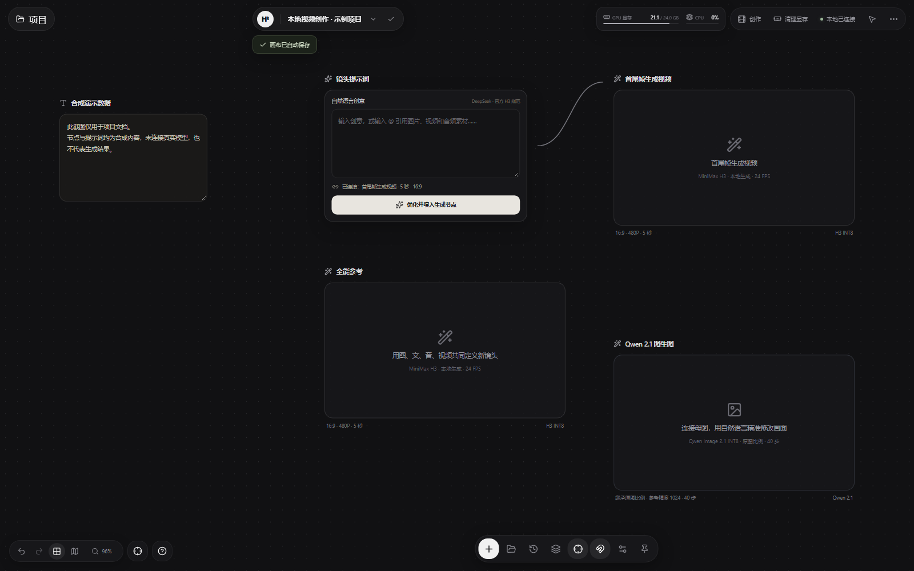

# H3 视频工作台

把本地 ComfyUI 包装为无限画布：素材引用、全能参考、首尾帧、角色替换、Krea2／MOSS 生图、Qwen 2.1 图生图、局部写实修复、无抠图换装、四视图、图片／视频高清和显存清理。Agent 协议 v2 提供 HTTP、CLI、MCP 和浏览器 WebMCP，可不打开浏览器完成建镜头、生成、选片与导出。

> **当前为开源发布候选版，不是稳定版。** 隔离测试、故障注入和构建已纳入统一入口；真实 Agent 队列全链路、三类干净环境安装和 8 小时规模长跑仍待完成。详见下方支持矩阵与 `docs/OPEN_SOURCE_REMEDIATION.md`。



## 功能支持矩阵

| 能力 | 当前状态 | 验证边界 |
|---|---|---|
| Windows + ComfyUI 0.42.5 | 已验证的目标组合 | 在线节点验证基于该版本；其他版本不保证兼容 |
| 项目、素材、自动保存与无限画布 | 已实现，隔离回归通过 | 覆盖持久化、切换、冲突、撤销、上传失败和关闭恢复；不含多人在线协作 |
| H3 核心模型配置 | `core-h3` 七项来源与哈希已登记 | 核心清单不代表完整 33 项已下载或全部通过真实 GPU 验收 |
| Krea2／MOSS／Qwen、换装与四视图 | 工作流已实现 | 共用合同和仿真回归不替代各模型、各输入质量下的真实生成验收 |
| Agent HTTP／CLI／MCP | 协议与故障注入已实现 | 编码、幂等、归属、Take 与导出使用隔离测试；真实 app 队列全链路待 QA-02 |
| 浏览器 WebMCP | 已实现 | 已验证排队成功语义；仍依赖当前页面与浏览器支持，后台 Agent 优先使用 HTTP／CLI／MCP |
| 网页视频链接导入 | 已实现 | 仅处理用户有权使用的公开内容；平台登录、反爬、地域限制和版权要求不由本项目绕过 |

## 已知限制

- 真实 `shot.create → generate → app queue → wait → Take → take.select → delivery.export` 尚未完成发布验收；直接 GPU 冒烟和仿真链路不能替代。
- 100 项目、50 GB 合成素材、8 小时连续运行尚未执行；短测性能不代表长期稳定性。
- Muse V3.0 FP8 的精确公开来源，以及部分模型的 SHA256、许可证与再分发条件仍待核实；未知项不得视为可商用或可再分发。
- 不提供在线协作、exe 安装包或自动更新。真实生成效果与速度取决于模型授权、显卡、显存、输入素材和工作流参数。

贡献开发请阅读 [`CONTRIBUTING.md`](CONTRIBUTING.md)；安全漏洞请按 [`SECURITY.md`](SECURITY.md) 私密报告，不要在公开 Issue 中粘贴令牌或私人素材。

## 许可证与商用边界

本仓库自有代码和文档采用 [Apache-2.0](LICENSE)，归属与第三方边界见 [NOTICE](NOTICE)。这不代表 ComfyUI、第三方节点、模型／LoRA、用户素材或生成输出也采用 Apache-2.0。

- 33 个模型的作者、官方页、许可证、商用与再分发状态逐项见 [`models/LICENSES.md`](models/LICENSES.md) 和机器可读 [`models/licenses.json`](models/licenses.json)。
- 六个锁定节点的许可证见 [`THIRD_PARTY_NOTICES.md`](THIRD_PARTY_NOTICES.md)；安装器独立克隆节点，不在本仓库捆绑其源码。
- H3 有适用地区、年收入、署名和生成内容披露等限制；Krea 2 有 100 万美元收入门槛；Qwen Image 2.1 和 Identity Edit V2 默认仅非商用。未知项不得视为可商用或可再分发。
- 网盘链接只是镜像，不授予额外权利。公开分发或商用前必须按作者官方页面复核最新条款。

## 环境要求

- Windows，ComfyUI 便携版；当前唯一完成在线节点验证的版本为 ComfyUI 0.42.5，更低版本不在支持矩阵中。
- NVIDIA 显卡；复杂 H3 角色替换建议 24 GB 显存，较低显存需自行缩短时长和降低分辨率。
- Git、Node.js 20.19+，以及足够的模型磁盘空间。
- 模型包共 33 个去重文件、164.803 GiB；权重不在 GitHub 仓库中。

## 最快安装

1. 把本仓库文件夹 `video-workbench` 放到 `ComfyUI_windows_portable` 根目录，使其旁边同时存在 `ComfyUI/` 和 `python_embeded/`。
2. 双击 `install.bat` 安装节点、Python 依赖并构建画布。
3. 打开 `models/SOURCES.md`，让 Agent 按其中的夸克原链接／官方备用链接逐项下载，并按清单重命名、放入临时模型目录。不要全量转存 TB 级分享。
4. 校验并复制已整理的模型：

   ```bat
   install.bat --models-source "D:\H3-Workbench-Models"
   ```

   也可以手动把模型目录复制到 `ComfyUI\models\`，无需重复运行安装器。
5. 双击 `启动.vbs`，浏览器打开 `http://127.0.0.1:8790/`；`start.bat` 仅用于调试，`停止.bat` 用于优雅停止。

安装器使用 `requirements.lock` 的 SHA256 校验 Python 依赖，并按 `install.py` 中的仓库＋commit 安装第三方节点。已有节点提交不一致时会保留原目录并停止，不会自动更新或覆盖；工作台自己的 `h3_workbench_refine` 节点会同步到 ComfyUI。便携版 Python 缺失时安装直接失败，不回退系统 Python。

仓库默认放在便携版根目录；其他位置需在启动前设置 `H3_COMFY_ROOT` 为便携版根目录。仓库路径包含空格或中文时使用同样的相对定位规则。

> **交给 Agent 安装：**让 Agent 先阅读仓库根目录的 [`AGENTS.md`](AGENTS.md)，再严格按其中步骤执行。该文件包含环境检查、下载、重命名、模型配置、节点安装和最终验收命令。

## 模型与 LoRA 下载链接

模型不上传到 GitHub。按下表进入原始分享或作者页面，再根据 [`models/SOURCES.md`](models/SOURCES.md) 的 33 项映射逐项下载；**不要全量转存 TB 级分享，也不要用同名旧版或其他量化版代替。**

| 模型内容 | 原始链接 | 清单内包含的主要内容 |
|---|---|---|
| MiniMax H3 主模型包 | https://pan.quark.cn/s/9ec095b95838 | FL2VA／REF2VA、32B 文本编码器、音频／视频 VAE、角色替换 LoRA |
| H3 局部重绘／补充包 | https://pan.quark.cn/s/b9409d65ed09 | H3 Turbo LoRA、INT8 视频 VAE、SAM3.1；部分文件需在分享内搜索确认 |
| Qwen Image 2.1 | https://pan.quark.cn/s/3df73f2e9f00 | Qwen 2.1 主模型、8B 文本编码器、VAE、Anything2RealCharacters 写实 LoRA |
| Krea2 全攻略 | https://pan.quark.cn/s/83b5ad9265e8 | Krea2 Turbo、4B 文本编码器、VAE、写实／亚洲／奇幻现实／复古动漫／水彩 LoRA |
| MOSS | https://pan.quark.cn/s/70e57d93e32d | MOSS 主模型、9B 文本编码器、FLUX2 VAE、SeedVR2 VAE |
| 四视图原视频分享 | https://pan.quark.cn/s/4b5a36d50e9c | 在分享内搜索 `QuadView_krea2_v1`；未逐项核实，搜不到用下方官方链接 |
| Muse V3.0 作者页 | https://civitai.com/models/2741166 | 当前公开文件与本机 V3.0 FP8 不完全匹配，不能下载后强行改名顶替 |
| Identity Edit V2 官方权重 | https://huggingface.co/conradlocke/krea2-identity-edit/resolve/main/krea2_identity_edit_v2.safetensors | `krea2_identity_edit_v2.safetensors` 完整版 |
| 四视图官方权重 | https://huggingface.co/Alissonerdx/CharacterSheet/resolve/main/QuadView_krea2_v1.safetensors | 下载后重命名为 `Krea2-四视图QuadView_krea2_v1.safetensors` |
| SeedVR2 3B 官方权重 | https://huggingface.co/Comfy-Org/SeedVR2/resolve/main/diffusion_models/seedvr2_3b_int8_convrot.safetensors | 必须是 3B INT8 ConvRot，不是 MOSS 包中的 7B |
| SAM3.1 官方备用 | https://huggingface.co/Comfy-Org/sam3.1/resolve/main/checkpoints/sam3.1_multiplex_fp16.safetensors | `sam3.1_multiplex_fp16.safetensors` |
| H3 latent 高清模型 | https://huggingface.co/LBH-123-AI/Minimax_h3_latent_Upscaler/resolve/main/minimax_h3_latent_upscaler_3d_conv_v1/minimax_h3_latent_upscaler_3d_conv_v1_fp16.safetensors | 下载后放在 `latent_upscale_models/` 根目录 |

所有模型的**精确目标路径、目标文件名、字节数**以 [`models/manifest.json`](models/manifest.json) 为准；夸克搜索名和必要重命名以 [`models/SOURCES.md`](models/SOURCES.md) 为准。

## 模型配置方法

以下两种方式任选其一，不要重复配置。

### 方式 A：复制或硬链接到 ComfyUI（推荐）

先将下载文件按清单整理到 `D:\H3-Workbench-Models`，然后在 ComfyUI 便携版根目录运行：

```bat
python_embeded\python.exe video-workbench\scripts\install_models.py "D:\H3-Workbench-Models" --comfy-root "."
```

脚本会校验文件名和字节数，再复制到 `ComfyUI\models\`。若临时模型目录与 `ComfyUI\models` 位于同一磁盘，可加 `--link` 使用硬链接，避免重复占用空间；跨盘不要加。

### 方式 B：保留外置模型目录

1. 将 [`extra_model_paths.example.yaml`](extra_model_paths.example.yaml) 复制为 `ComfyUI\extra_model_paths.yaml`。
2. 把 `base_path` 改成整理后的模型根目录，例如 `D:/H3-Workbench-Models`。
3. 保留各类目相对路径不变，重启 ComfyUI。

采用方式 B 时，最终校验要额外传入 `--model-root "D:\H3-Workbench-Models"`。模型目录结构示例见 [`models/README.md`](models/README.md)。

## AI 提示词优化（可选）

普通本地生成不需要 API 密钥。只有“AI 优化提示词”需要 DeepSeek：在本目录创建 `deepseek.key`，只写入密钥；也可使用环境变量 `DEEPSEEK_API_KEY`。密钥文件已被 Git 忽略，不要提交或分享。

## 模型包

完整路径、目标文件名、字节数和已登记的 SHA256 见 `models/manifest.json`，目录说明见 `models/README.md`。**逐文件夸克原链接、官方备用、重命名规则及 Agent 安装步骤见 `models/SOURCES.md`。** 不再依赖统一网盘总包；其中 Muse V3.0 FP8 的完全匹配公开文件仍待核实，文档已明确标注。

新用户先安装 7 个核心 H3 权重（71.164 GiB），全部可从 `https://huggingface.co/Comfy-Org/MiniMax-H3` 按清单相对路径直接下载。核心配置校验：

```bat
python_embeded\python.exe video-workbench\scripts\verify_workbench.py --profile core-h3
```

省略 `--profile` 时默认校验完整 33 项。已登记 SHA256 的文件会校验实际内容；其余文件只校验字节数并显示“待核实”。

直接校验已整理的核心模型目录：

```bat
python scripts\verify_workbench.py --model-root "D:\H3-Workbench-Models" --comfy-root ".." --profile core-h3
```

生成一个用于上传网盘的规范目录（本机维护者使用）：

```bat
python scripts\prepare_cloud_package.py --model-root "C:\ComfyUI_windows_portable\ComfyUI\models" --model-root "D:\H3-Models" --output "D:\H3-Workbench-Models" --mode copy
```

同盘可使用 `--mode hardlink` 避免重复占用空间；跨盘必须使用 `copy`。先用 `--dry-run` 检查匹配结果。

## 自动安装的第三方节点

- `akatz-ai/h3-relay`
- `kijai/ComfyUI-KJNodes`
- `lbouaraba/comfyui-krea2edit`
- `lquesada/ComfyUI-Inpaint-CropAndStitch`
- `LBH-123-AI/Comfyui_Minimax_h3_latent_Upscaler`
- `Rkkss/ComfyUI-Spectrum-MOSS`

MiniMax H3、Qwen 2.1、SAM3、SeedVR2 和循环节点由新版 ComfyUI 本体提供。某些加速注意力还依赖本机显卡与 ComfyUI 的 optional attention runtime；不能用时应切换普通注意力，而不是强行安装不兼容的 GPU 包。

## 数据与隐私

- 服务只监听 `127.0.0.1`。
- 已存在的旧数据目录 `D:\H3_Workbench` 会继续使用；首次启动从固定磁盘中选择剩余空间充足的位置，不要求存在 D 盘。可用 `H3_WORKBENCH_DATA_DIR` 显式指定参考素材和生成结果目录。
- 项目默认保存在 `%USERPROFILE%\Documents\H3 Workbench`，可在设置中更改项目根目录；数据目录或项目目录变更均不会自动迁移旧内容。
- 应用与自有 ComfyUI 日志位于运行目录 `logs/`，每个当前日志最大 10 MB、保留 5 个轮转备份。请求日志不记录 URL、素材名或查询参数；日志和诊断包会脱敏常见令牌、Cookie 与密钥。
- 仓库不包含人物母图、测试生成素材、浏览器 Cookie、API 密钥或模型权重。

## 画布项目列表

点击左上角项目名称旁的箭头打开项目列表，可搜索、切换或新建画布；直接编辑左上角名称即可重命名。切换前会先保存当前项目，生成或提示词优化期间暂不能切换。

每个项目独立保存节点、连线、视口和素材到项目文件夹，空画布也会保存。列表中的“协作”当前仅显示说明，不提供在线共享。保存失败时界面会提示并保留当前画布，避免切换后丢失修改；多个窗口编辑同一项目时会通过项目锁和 revision 阻止旧版本覆盖新版本。

删除节点不会立即删除项目素材；孤儿素材清理由独立操作执行，并保留历史版本仍引用的文件。替换素材只有在写入成功后才会切换引用。

## 队列与通知

后台队列在后端持久化，关闭浏览器标签页不会取消排队或生成。单个任务超过 60 分钟没有返回结果会标记为 `COMFY_TIMEOUT` 并允许按原配方重试；取消只删除目标排队项，且仅在目标任务正在执行时发送中断。任务完成、失败和队列清空时，工作台显示页内提示；在设置中启用通知并允许浏览器权限后，也会发送系统通知。标签页关闭期间无法弹出浏览器通知，重新打开时会汇总提示已结束的任务。

## Agent 协议 v2

Agent 默认使用后端 HTTP、CLI 或 MCP，无需打开浏览器。完整接口、凭据、MCP 配置和全链路示例见 [`docs/AGENT.md`](docs/AGENT.md)；日常操作规范见 `.agents/skills/comfyui-infinite-canvas/SKILL.md`。

```bat
C:\ComfyUI_windows_portable\python_embeded\python.exe agent_cli.py state --project prj_xxx
C:\ComfyUI_windows_portable\python_embeded\python.exe agent_mcp.py
C:\ComfyUI_windows_portable\python_embeded\python.exe scripts\agent_benchmark.py
```

## 常用开发检查

```bat
python -m pip install --require-hashes -r requirements.lock
npm ci
npm run browser:install
npm run build
npm run test:all
```

`test:all` 依次运行全部 Python 单元／故障注入测试、17 个纯 Node 测试文件和 5 个隔离浏览器／后端测试文件；不需要真实模型、ComfyUI 任务或用户项目。浏览器默认使用 Playwright 托管 Chromium，也可用 `CHROME_PATH` 指定浏览器；后端浏览器测试默认使用 PATH 中的 `python`，可用 `H3_TEST_PYTHON` 覆盖。CI 配置见 `.github/workflows/ci.yml`，覆盖 Windows 默认编码、UTF-8、前端构建及临时目录中的隔离验收。

更新 Python 版本约束后，在便携版根目录执行 `python_embeded\python.exe video-workbench\scripts\generate_requirements_lock.py` 重建哈希锁。`requirements.txt`、`requirements.lock` 和生成脚本的变更必须放在同一个可独立审查的提交中。
